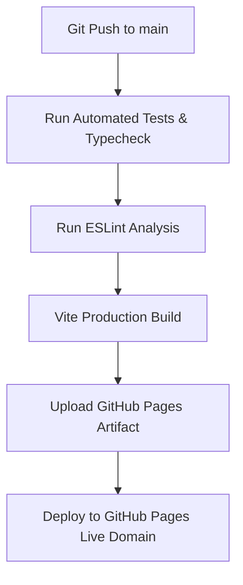

# Mahmoud Ahmed Obaidon — DevOps & Cloud Engineering Portfolio

[](https://github.com/Eng-m-devops/Portfolio/actions/workflows/deploy.yml)
[](https://Eng-m-devops.github.io/Portfolio/)
[](LICENSE)
[](https://www.linkedin.com/in/mahmoodobidoon)

معرض الأعمال والخبرات المهنية الخاص بـ **محمود أحمد عبيدون** — مهندس DevOps وحوسبة سحابية. تم تصميم وبناء هذا المعرض باستخدام أحدث التقنيات لتقديم تجربة تفاعلية سريعة، متجاوبة، ومبنية على مبادئ الهندسة السحابية الحديثة والتكامل المستمر (CI/CD).

---

## الميزات الرئيسية (Key Features)

- ** محاكي الأوامر التفاعلي (Interactive TTY Shell):** إمكانية تجربة أوامر TTY مباشرة من الصفحة وتفحص حالة النظام والمشاريع بشكل تفاعلي حي.
- ** دعم ثنائي اللغة (Bilingual Support AR/EN):** نظام ترجمة فوري كامل (i18n) بين اللغة العربية والإنجليزية مع مراعاة اتجاهات النص (RTL/LTR).
- **المظهر الداكن والفيزيائي (Dark & Light Theme):** تبديل سلس بين المظهر المظلم العصري الفخم والمظهر المضيء.
- ** أداء فائق وتصميم متجاوب:** سرعة استجابة عالية مع توافق كامل مع كافة الشاشات والأجهزة اللوحية والمحمول.
- ** موثوقية الأكواد والأدلة:** ربط المشاريع بمستودعاتها الحقيقية على GitHub، وإرفاق المخططات المعمارية وخطوات التحقق والنتائج المقاسة لكل مشروع.
- ** تحميل السيرة الذاتية PDF:** رابط مباشر وديناميكي متوافق مع كافة مسارات GitHub Pages لتنزيل النسخة المحدثة من CV.

---

## الترسانة التقنية (Tech Stack)

| فئة التقنية           | التقنيات المستخدمة                               |
| :-------------------- | :----------------------------------------------- |
| **Front-end & Core**  | React 18, TypeScript, Vite 5, React Router v6    |
| **Styling & UI**      | Tailwind CSS v3, Lucide React Icons, Radix UI    |
| **CI/CD & Hosting**   | GitHub Actions Workflow, GitHub Pages Deployment |
| **Quality & Linting** | ESLint 9, TypeScript Typechecking (`tsc`)        |

---

## خط النشر والتشغيل الآلي (CI/CD Pipeline Workflow)

يحتوي المستودع على خط نشر مؤتمت بالكامل عبر **GitHub Actions** (`.github/workflows/deploy.yml`) يعمل على إجراء الخطوات التالية عند كل تدقيق أو سحب (Push / Pull Request) لفرع `main`:



1. **التحقق من الأنواع (Typecheck):** التأكد من خلو المشروع من أخطاء TypeScript.
2. **فحص جودة الكود (Linting):** فحص التنسيق والمعايير القياسية عبر ESLint.
3. **التجميع للإنتاج (Vite Build):** تجميع الأصول والملفات الثابتة إلى مجلد `dist/`.
4. **النشر التلقائي (Automated Deployment):** رفع حزمة الموقع ونشرها مباشرة على GitHub Pages.

---

## التشغيل المحلي والتطوير (Local Setup & Development)

### المتطلبات الأساسية

- Node.js (الإصدار 18 أو أحدث)
- npm أو bun أو yarn

### خطوات التشغيل:

```bash
# 1. استنساخ المستودع
git clone https://github.com/Eng-m-devops/Portfolio.git
cd Portfolio

# 2. تثبيت الحزم والاعتماديات
npm install

# 3. تشغيل سيرفر التطوير المحلي
npm run dev
```

سيتم فتح سيرفر التطوير التفاعلي على الرابط: `http://localhost:8080`

### أوامر البناء والفحص:

```bash
# تجميع حزمة الإنتاج
npm run build

# فحص جودة الكود عبر ESLint
npm run lint

# معاينة حزمة الإنتاج محلياً
npm run preview
```

---

## معلومات التواصل والروابط الرسمية (Contact & Profiles)

- **الاسم:** محمود أحمد عبيدون (Mahmoud Ahmed Obaidon)
- **المسمى الوظيفي:** مهندس DevOps وحوسبة سحابية (DevOps & Cloud Infrastructure Engineer)
- **الموقع الجغرافي:** تريم، حضرموت — اليمن
- **البريد الإلكتروني:** [mhmoodobidoon@gmail.com](mailto:mhmoodobidoon@gmail.com)
- **رابط LinkedIn:** [linkedin.com/in/mahmoodobidoon](https://www.linkedin.com/in/mahmoodobidoon)
- **حساب GitHub:** [github.com/Eng-m-devops](https://github.com/Eng-m-devops)
- **الهاتف / الواتساب:** [+967 772 944 392](https://wa.me/967772944392)

---

&copy; 2026 محمود أحمد عبيدون. جميع الحقوق محفوظة.
